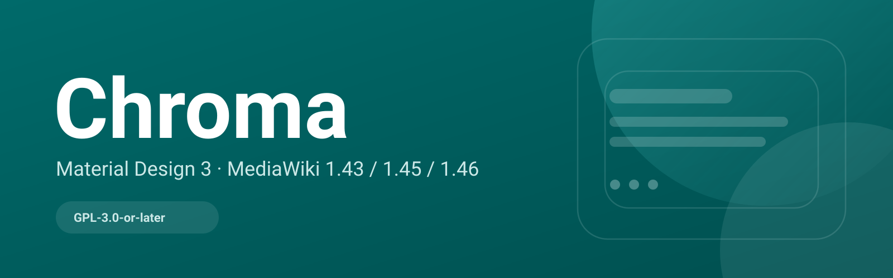
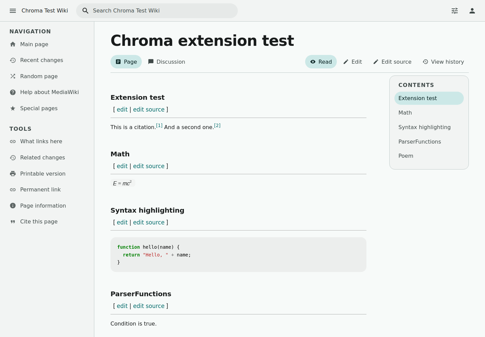

<p align="right"><a href="https://github.com/chroma-mediawiki/.github/blob/main/profile/README.md">简体中文</a> · <strong>English</strong></p>

<div align="center">


# Chroma

**Color for MediaWiki.**

A color-first, reading-first MediaWiki skin built on Material 3-style design tokens.

[English docs](https://chroma-mediawiki.github.io/en/) · [中文文档](https://chroma-mediawiki.github.io/) · [Skin repository](https://github.com/chroma-mediawiki/mediawiki-skins-Chroma) · [Docs repository](https://github.com/chroma-mediawiki/chroma-mediawiki.github.io) · [QQ](https://qm.qq.com/q/zSaZRWS4eY) · [Bilibili](https://b23.tv/QiGlLcm)

[](https://github.com/chroma-mediawiki/mediawiki-skins-Chroma/blob/main/LICENSE)
[](https://chroma-mediawiki.github.io/en/guide/compatibility)
[](https://github.com/chroma-mediawiki/mediawiki-skins-Chroma/releases)

</div>



## What is Chroma?

Chroma brings a Material 3-style **design token** layer to MediaWiki: semantic color roles, type scale, shape, elevation, motion and state layers. It then applies those tokens through two layouts, a focused reading mode and a full MobileFrontend takeover.

It is not a complete Material 3 component library, and it does not replace MediaWiki's content model. Pages, talk, history, editors and extensions stay powered by MediaWiki; the skin owns presentation, hierarchy and reading rhythm.

## Why Chroma

- **Color as a system** — seed `#006A6A`, eight presets, light/dark/system, one `--md-sys-*` token set.
- **Reading first** — app and reading layouts, a reading mode that removes tools, nested TOC with scroll-spy.
- **Mobile without MinervaNeue** — set `$wgDefaultMobileSkin = 'chroma'` and mobile UAs use Chroma directly.
- **Built for real wikis** — extension matrix, special pages, Codex/OOUI surfaces, no external CDN requests.

## Repositories

| Repository | What it is |
|---|---|
| [mediawiki-skins-Chroma](https://github.com/chroma-mediawiki/mediawiki-skins-Chroma) | The skin: PHP, Mustache template, CSS tokens, JS, i18n, releases |
| [chroma-mediawiki.github.io](https://github.com/chroma-mediawiki/chroma-mediawiki.github.io) | The official bilingual documentation site, built with VitePress |

## Quick start

```php
wfLoadSkin( 'Chroma' );
$wgDefaultSkin = 'chroma';

// Optional: MobileFrontend takeover
$wgDefaultMobileSkin = 'chroma';
```

Download the ZIP for your MediaWiki line:

| MediaWiki | Release |
|---|---|
| 1.43 LTS | [v0.6.0-REL1_43](https://github.com/chroma-mediawiki/mediawiki-skins-Chroma/releases/tag/v0.6.0-REL1_43) |
| 1.45 | [v0.6.0-REL1_45](https://github.com/chroma-mediawiki/mediawiki-skins-Chroma/releases/tag/v0.6.0-REL1_45) |
| 1.46 | [v0.6.0-REL1_46](https://github.com/chroma-mediawiki/mediawiki-skins-Chroma/releases/tag/v0.6.0-REL1_46) |

## Screenshot



## License

GPL-3.0-or-later. Chroma is an independent community project, not affiliated with or endorsed by Google. Material Design and Material 3 are trademarks of Google LLC.
