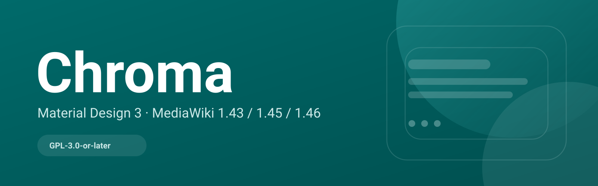
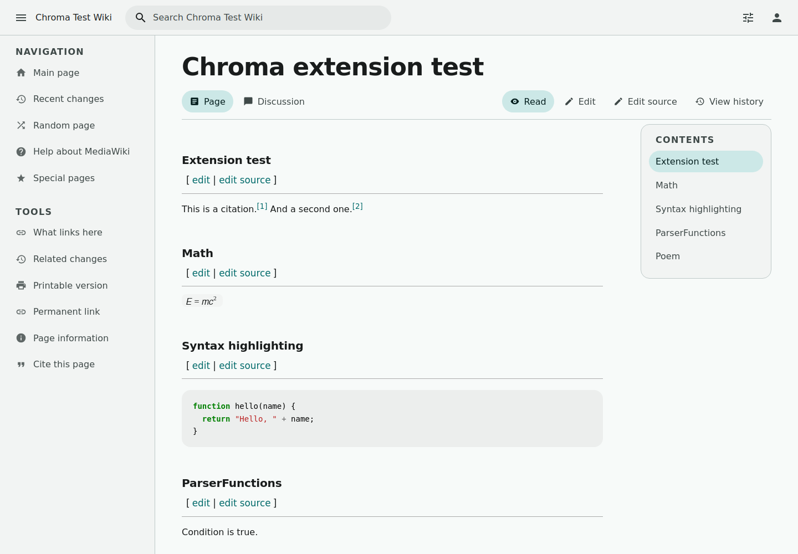

<p align="right"><strong>简体中文</strong> · <a href="https://github.com/chroma-mediawiki/.github/blob/main/profile/README.en.md">English</a></p>

<div align="center">


# Chroma

**给 MediaWiki 上色。**

色彩驱动、阅读优先的 MediaWiki 皮肤，基于 Material 3 风格的 design token。

[中文文档](https://chroma-mediawiki.github.io/chroma-docs/) · [English docs](https://chroma-mediawiki.github.io/chroma-docs/en/) · [皮肤仓库](https://github.com/chroma-mediawiki/mediawiki-skins-Chroma) · [文档仓库](https://github.com/chroma-mediawiki/chroma-docs)

[](https://github.com/chroma-mediawiki/mediawiki-skins-Chroma/blob/main/LICENSE)
[](https://chroma-mediawiki.github.io/chroma-docs/guide/compatibility)
[](https://github.com/chroma-mediawiki/mediawiki-skins-Chroma/releases)

</div>



## Chroma 是什么

Chroma 把 Material 3 风格的 **design token** 带进 MediaWiki：语义色彩角色、字阶、形状、海拔、动效与状态层，再通过两种布局、阅读模式和 MobileFrontend 全接管落到 wiki 的阅读与编辑界面里。

它不是完整的 Material 3 组件库，也不重造 MediaWiki 的内容模型。页面、讨论、历史、编辑器和扩展仍由 MediaWiki 驱动；皮肤负责呈现、层级和阅读节奏。

## 为什么是 Chroma

- **色彩是系统**：默认 seed `#006A6A`，四套预设，浅色/深色/跟随系统，统一 `--md-sys-*` token。
- **阅读优先**：应用式与阅读式布局，阅读模式收起工具，嵌套目录 + scroll-spy。
- **不依赖 MinervaNeue 的手机端**：设置 `$wgDefaultMobileSkin = 'chroma'`，手机 UA 直接使用 Chroma。
- **为真实 wiki 而做**：扩展矩阵、特殊页、Codex/OOUI surface，无外部 CDN 请求。

## 仓库

| 仓库 | 说明 |
|---|---|
| [mediawiki-skins-Chroma](https://github.com/chroma-mediawiki/mediawiki-skins-Chroma) | 皮肤本体：PHP、Mustache 模板、CSS token、JS、i18n、Release |
| [chroma-docs](https://github.com/chroma-mediawiki/chroma-docs) | 官方中英双语文档站，使用 VitePress 构建 |

## 快速开始

```php
wfLoadSkin( 'Chroma' );
$wgDefaultSkin = 'chroma';

// 可选：MobileFrontend 全接管手机端
$wgDefaultMobileSkin = 'chroma';
```

下载对应 MediaWiki 版本线的 ZIP：

| MediaWiki | Release |
|---|---|
| 1.43 LTS | [v0.5.2-REL1_43](https://github.com/chroma-mediawiki/mediawiki-skins-Chroma/releases/tag/v0.5.2-REL1_43) |
| 1.45 | [v0.5.2-REL1_45](https://github.com/chroma-mediawiki/mediawiki-skins-Chroma/releases/tag/v0.5.2-REL1_45) |
| 1.46 | [v0.5.2-REL1_46](https://github.com/chroma-mediawiki/mediawiki-skins-Chroma/releases/tag/v0.5.2-REL1_46) |

## 截图



## 许可

GPL-3.0-or-later。Chroma 是独立社区项目，与 Google 无关联，也未获其背书。Material Design 与 Material 3 是 Google LLC 的商标。
